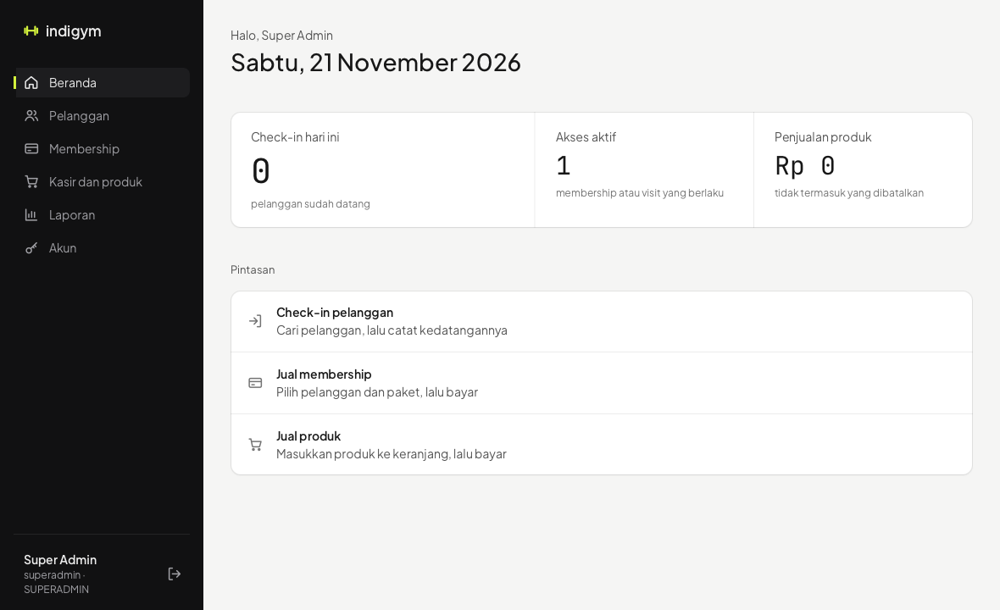
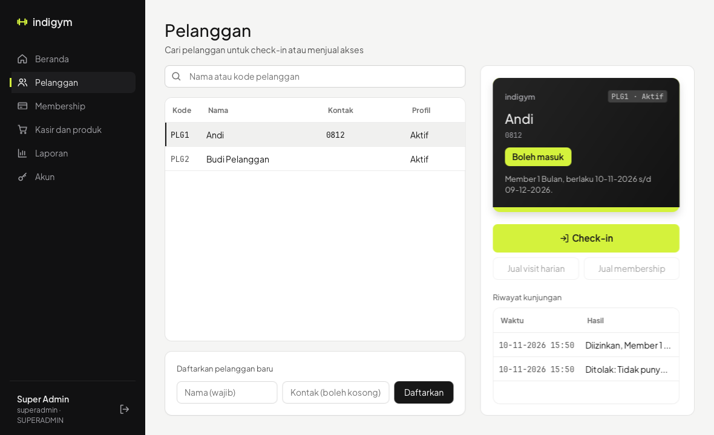
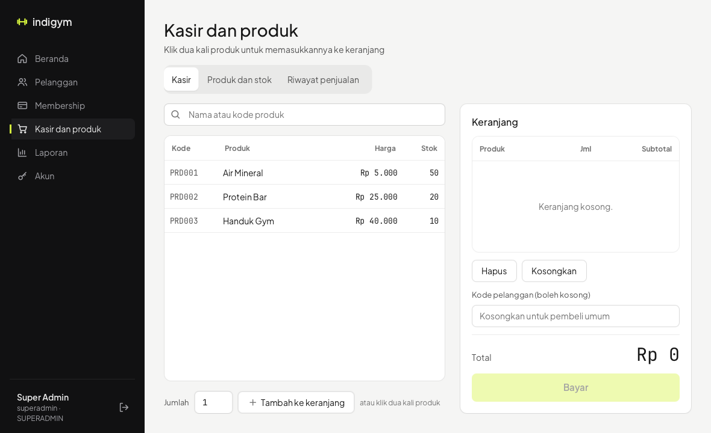
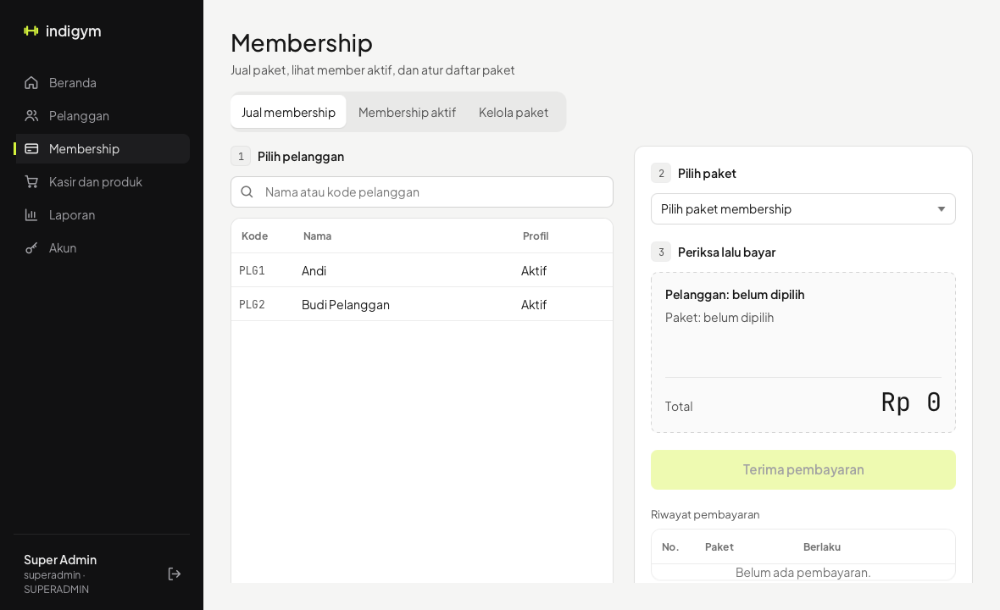
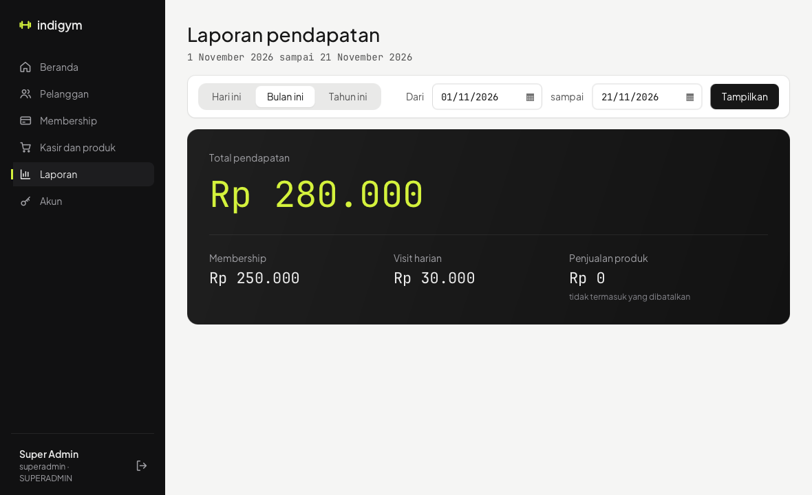

# IndiGym

IndiGym merupakan aplikasi desktop untuk membantu operasional sebuah gym, dimana petugas di meja depan bisa mengelola pelanggan, menjual akses masuk (visit harian dan membership), mencatat check-in, menjual produk seperti air mineral atau handuk, sampai melihat pendapatan dalam satu periode. Aplikasi ini kami buat sebagai proyek akhir mata kuliah PBO, jadi selain berjalan sebagai aplikasi yang utuh, struktur kodenya sengaja dibuat supaya konsep OOP seperti Inheritance, Polimorfisme, Abstract Class, dan Interface bisa ditunjukkan langsung dari kodenya.

Teknologi yang dipakai adalah Java 21, Maven, JavaFX (tampilan dibuat dengan FXML dan Scene Builder), dan MySQL sebagai database.



## Fitur

Aplikasi ini dipakai oleh dua jenis akun, yaitu Admin dan SuperAdmin. Admin menjalankan pekerjaan harian di meja depan, sedangkan SuperAdmin punya kewenangan tambahan untuk mengelola akun Admin lain.

Pertama, **akun dan login**. Setiap Admin masuk dengan username dan password, dimana password disimpan dalam bentuk hash, bukan teks biasa. SuperAdmin bisa menambah Admin baru, mereset password, dan menonaktifkan akun, sedangkan Admin biasa hanya bisa mengganti password miliknya sendiri. Pengecekan kewenangan ini dilakukan di Service, bukan sekadar menyembunyikan bagian layar, karena kalau hanya disembunyikan, aturannya masih bisa dilewati.

Kedua, **pelanggan**. Pelanggan baru didaftarkan dengan nama dan kontak, lalu otomatis mendapat kode seperti `PLG1`. Datanya bisa dicari, diubah, dan diarsipkan (tidak dihapus, supaya riwayat kunjungan dan pembayarannya tetap utuh). Saat satu pelanggan dipilih, panel di sebelah kanan langsung menunjukkan apakah ia boleh masuk hari ini atau belum punya akses.

Ketiga, **akses harian dan membership**. Paket bawaannya ada tiga, yaitu Visit Harian (Rp 30.000), Member 1 Bulan (Rp 250.000), dan Member 12 Bulan (Rp 2.500.000), dan paket membership baru bisa ditambah atau diarsipkan dari layar Membership. Sebelum pembayaran diterima, petugas melihat dulu ringkasan harga dan periode berlakunya. Pelanggan yang membership-nya masih berjalan tidak bisa membeli membership lagi sampai yang lama berakhir, dan kalau hari ini ia sudah memakai visit harian, membership baru dimulai besok. Setelah dibayar, bukti pembayaran langsung tampil.

Keempat, **check-in**. Check-in hanya diterima kalau pelanggan punya akses yang berlaku hari itu. Kalau tidak, check-in ditolak, dan penolakannya tetap tercatat di riwayat kunjungan. Kalau pelanggan check-in lebih dari sekali dalam sehari, aplikasi meminta konfirmasi dulu untuk kunjungan tambahan tersebut.

Kelima, **kasir dan stok produk**. Produk dimasukkan ke keranjang dengan klik dua kali, jumlahnya tidak boleh melebihi stok, lalu dibayar dan struknya tampil. Stok berkurang otomatis setelah pembayaran. Transaksi yang salah bisa dibatalkan dengan menuliskan alasannya, dan stoknya kembali. Pembeli boleh umum (kode pelanggan dikosongkan) atau diisi dengan kode pelanggan. Produk sendiri bisa ditambah, diubah harganya, ditambah stoknya, dan diarsipkan.

Keenam, **laporan pendapatan**. Laporan menghitung pendapatan membership, visit harian, dan produk, lalu menjumlahkannya. Periodenya bisa dipilih lewat tombol Hari ini, Bulan ini, atau Tahun ini, atau dengan mengisi tanggal sendiri. Transaksi produk yang sudah dibatalkan tidak ikut dihitung, dan tanggal awal yang lebih besar dari tanggal akhir akan ditolak.

Terakhir, **beranda** yang merangkum keadaan hari ini, yaitu jumlah check-in, jumlah pelanggan yang aksesnya sedang berlaku, dan total penjualan produk, ditambah pintasan ke check-in, jual membership, dan jual produk.

| | |
| --- | --- |
|  |  |
|  |  |

## Cara menjalankan

Setiap anggota memakai MySQL di laptopnya sendiri, dan langkah di bawah cukup dilakukan sekali. Versi ringkas yang sama ada di [SETUP.md](SETUP.md).

### 1. Yang perlu diinstall

JDK 21 (versi yang lebih baru juga bisa), Maven, dan MySQL. Scene Builder hanya dibutuhkan kalau ingin membuka atau mengubah berkas FXML. Di macOS, MySQL bisa dipasang dan dijalankan dengan:

```bash
brew install mysql && brew services start mysql
```

Di Windows, install MySQL Community Server lalu pakai `mysql -uroot -p` pada langkah berikutnya.

### 2. Siapkan database

Jalankan tiga perintah ini dari folder proyek. Perintah pertama membuat database `indigym`, yang kedua mengisi tabel-tabelnya, dan yang ketiga mengisi data awal (satu akun `superadmin`, tiga paket akses, dan tiga produk contoh).

```bash
mysql -uroot -e "CREATE DATABASE IF NOT EXISTS indigym"
```

```bash
mysql -uroot indigym < database/01_skema.sql
```

```bash
mysql -uroot indigym < database/02_data_awal.sql
```

Kalau ingin mengulang dari nol, jalankan `mysql -uroot -e "DROP DATABASE indigym"` lalu ulangi tiga perintah di atas. Hati-hati, karena perintah itu menghapus seluruh isi database `indigym`, termasuk data yang sudah dicoba.

### 3. Siapkan konfigurasi koneksi

```bash
cp config/db.example.properties config/db.properties
```

Isi bawaannya memakai user `root` tanpa password, sesuai MySQL dari Homebrew. Kalau MySQL-mu memakai password, isi `db.password` di `config/db.properties`. Berkas ini sudah masuk `.gitignore`, jadi tidak ikut ter-commit.

### 4. Jalankan aplikasi

```bash
mvn clean verify
```

```bash
mvn javafx:run
```

Perintah pertama mengompilasi proyek sekaligus menjalankan tes, dan perintah kedua membuka aplikasinya. Login awalnya memakai username `superadmin` dan password `admin123`. Sebaiknya password ini diganti lewat menu Akun setelah login pertama.

Kalau muncul error koneksi saat login, biasanya penyebabnya salah satu dari tiga hal: MySQL belum menyala, database `indigym` belum dibuat, atau isi `config/db.properties` tidak cocok dengan MySQL di laptop.

## Struktur proyek

```
src/main/java/id/indigym/
├── MainApp.java        pindah layar, dialog, dan pesan hasil aksi
├── model/              class data + Rupiah (format uang)
├── database/           Database + 4 DAO (hanya SQL)
├── service/            Sesi + 5 service (aturan bisnis)
└── controller/         7 controller layar + NavigasiController (menu samping)
src/main/resources/fxml/    7 layar + navigasi.fxml, bisa dibuka di Scene Builder
src/main/resources/css/     application.css (satu-satunya file gaya)
src/main/resources/fonts/   JetBrains Mono untuk label kecil dan struk
src/test/java/              tes unit
database/                   01_skema.sql, 02_data_awal.sql
config/                     db.example.properties (contoh konfigurasi koneksi)
```

## Pengujian

`mvn clean verify` menjalankan tes yang tidak butuh database, yaitu perhitungan tanggal membership, keranjang, hash password, kewenangan, dan rentang laporan, jadi tes ini tetap bisa jalan walaupun MySQL belum menyala. Alur yang memakai database dicoba manual lewat skenario di [docs/demo.md](docs/demo.md), mulai dari login, daftar pelanggan, jual membership, check-in, kasir, sampai laporan.
