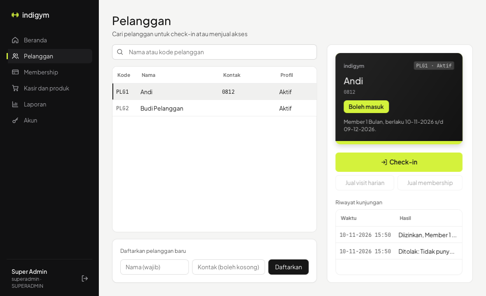
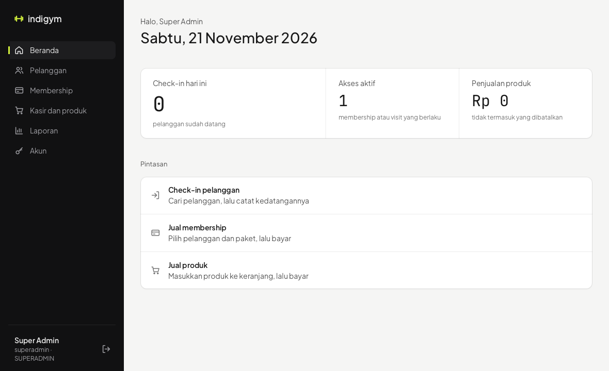
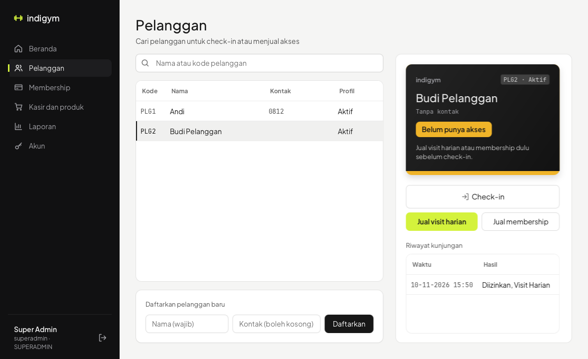
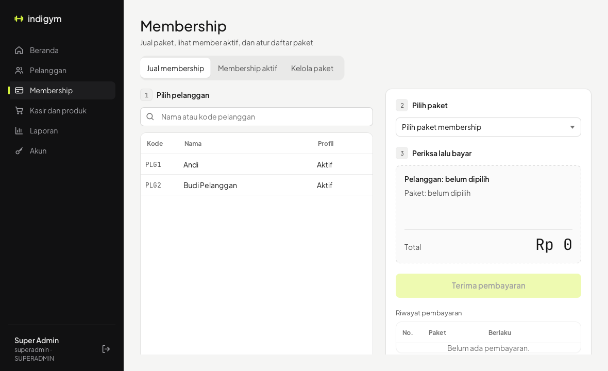
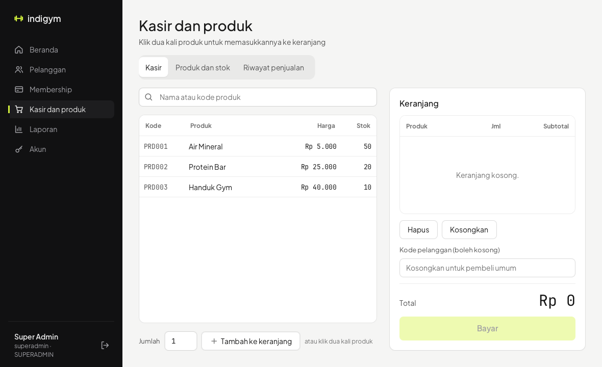
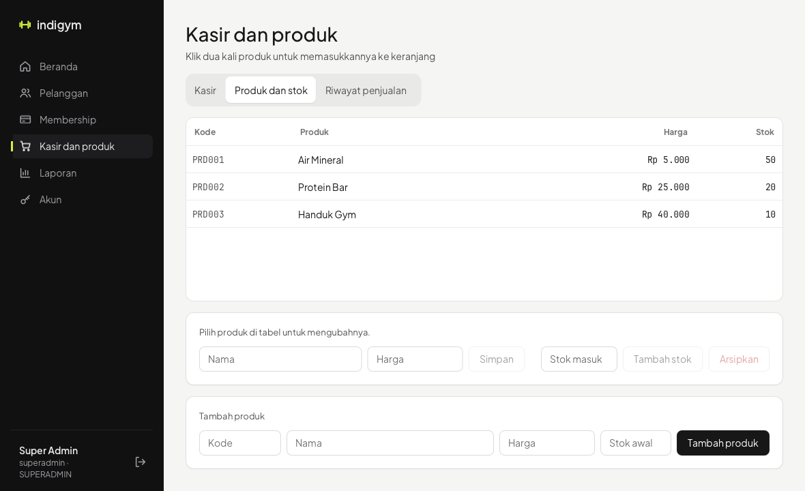
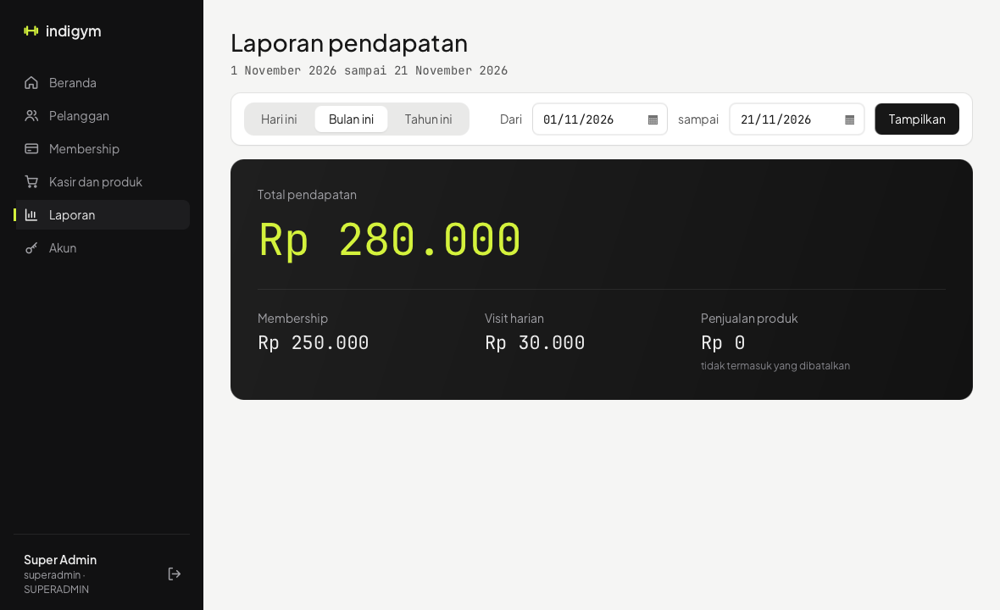
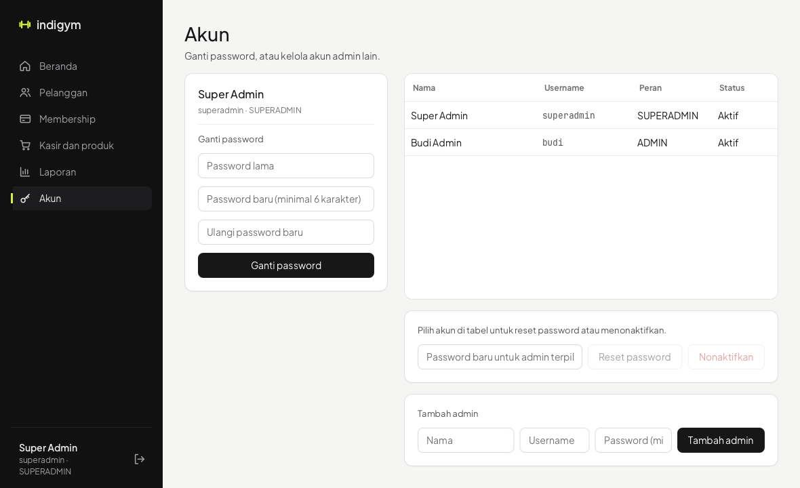
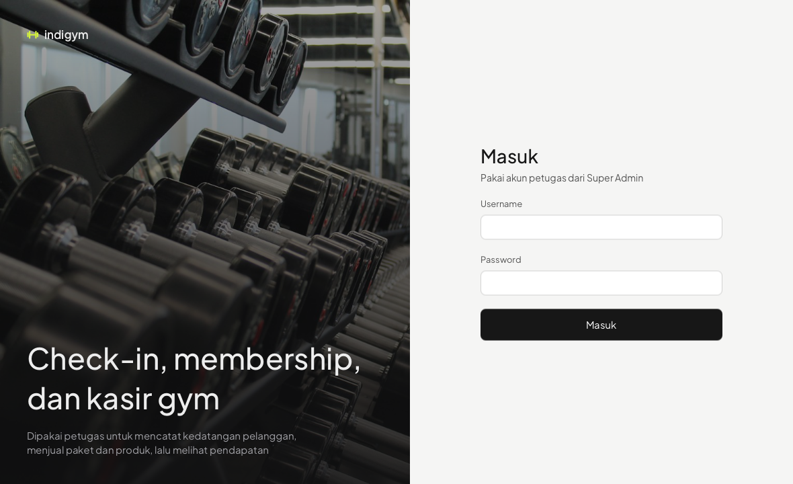

# Acuan Desain IndiGym: "Meja Depan"

Semua layar IndiGym mengikuti acuan ini. Dunianya adalah meja resepsionis gym: sidebar hitam seperti lantai karet, latar abu-abu netral yang nyaman dilihat berjam-jam, dan satu aksen lime seperti lakban neon di lantai gym. Draft HTML yang menjadi dasar tema ini ada di [`draft-ui/index.html`](../draft-ui/index.html).

Semua aturan tampilan ada di satu file, [`src/main/resources/css/application.css`](../src/main/resources/css/application.css). FXML cukup memakai **nama kelas** dari file itu.



## 1. Prinsip tampilan

1. **Bingkai tenang, isi yang berbicara.** Latar, kartu, garis, dan teks memakai abu-abu netral. Warna kaya hanya muncul di dua momen: kartu member di layar Pelanggan dan kotak total di Laporan.
2. **Lime dipakai hemat.** `warna-aksen` hanya untuk garis menu aktif, tombol transaksi (Check-in, Terima pembayaran, Bayar), kartu member yang boleh masuk, dan angka total pendapatan. Tombol formulir biasa memakai hitam.
3. **Ciri khas: tag kode.** Kode pelanggan dan produk tampil sebagai tag mono kecil, seperti tag kunci loker (kelas `tag`).
4. **Dua huruf, dua peran.** JetBrains Mono untuk angka, uang, kode, tanggal, dan struk. Plus Jakarta Sans (buatan Tokotype, Jakarta) untuk kalimat, nama orang, dan tombol. Hierarki dibuat dari ukuran dan warna, bukan dari ketebalan.
5. **Warna punya arti.** Hijau berarti berhasil, kuning berarti perlu tindakan, merah berarti ditolak, gagal, atau menutup sesuatu. Warna selalu disertai teks, tidak pernah berdiri sendiri.
6. **Kedalaman dari garis tipis dan bayangan halus.** Kartu memakai garis 8% dan bayangan kecil. Tidak ada glow, gradien antar-warna, atau blur.

## 2. Prinsip pengalaman pengguna

Aturan ini yang membuat aplikasi tidak membingungkan. Ikuti saat membuat atau mengubah layar.

1. **Navigasi selalu terlihat.** Menu samping ada di semua layar dan menandai layar yang sedang dibuka. Tidak ada tombol "Kembali".
2. **Pilih dulu, baru bertindak.** Layar berpola daftar di kiri dan panel detail di kanan. Panel menunjukkan keadaan objek terpilih (misalnya akses hari ini) **sebelum** petugas menekan tombol.
3. **Tombol yang tidak berlaku dimatikan.** Contohnya "Jual visit harian" mati jika pelanggan sudah punya akses. Keterangan di dekatnya menjelaskan alasannya. Check-in sengaja tetap aktif walau akan ditolak, karena penolakan juga dicatat.
4. **Tombol utama mengikuti langkah yang disarankan.** Pelanggan yang belum punya akses: tombol utamanya "Jual visit harian". Yang sudah punya akses: "Check-in".
5. **Periksa sebelum bayar.** Setiap pembayaran menampilkan ringkasan (pelanggan, paket, harga, periode) lalu dialog konfirmasi.
6. **Hasil aksi selalu dijawab.** Bilah pesan di atas layar berwarna hijau (berhasil) atau merah (gagal), berisi satu kalimat pendek tentang apa yang terjadi.
7. **Jangan membuat petugas mencari dua kali.** Pelanggan yang baru didaftarkan langsung terpilih, tombol "Jual membership" membawa pelanggan yang sama ke layar Membership, dan setelah bayar aplikasi kembali ke layar Pelanggan untuk check-in.
8. **Bahasa petugas.** Tulis "Jual visit harian" dan "Boleh masuk", bukan istilah program. Judul, label, dan tombol tanpa titik di akhir dan tanpa tanda seru. Label ditulis biasa, bukan HURUF BESAR.

## 3. Warna

Didefinisikan sekali di `.root` pada CSS.

| Token | Nilai | Dipakai untuk |
| --- | --- | --- |
| `warna-latar` | `#f5f5f4` | Latar jendela |
| `warna-panel` | `#ffffff` | Kartu, tabel, kolom input |
| `warna-naik` | `#f0f0ef` | Hover, baris terpilih, kotak nomor langkah |
| `warna-garis` | teks 8% | Garis pembatas tipis |
| `warna-garis-kuat` | teks 16% | Tepi input dan tombol |
| `warna-teks` | `#171717` | Teks utama, tombol utama, fokus |
| `warna-teks-2` | `#525252` | Teks pendukung, label bagian |
| `warna-teks-redup` | `#737373` | Meta, placeholder, kepala tabel, ikon |
| `warna-sisi` / `-naik` | `#111112` / `#1d1d1f` | Sidebar, menu hover dan aktif |
| `warna-sisi-teks` / `-terang` | `#a1a1a6` / `#ededed` | Teks menu |
| `warna-aksen` | `#d4f23c` | Lime: menu aktif, tombol transaksi, kartu member, angka total |
| `warna-aksen-tekan` | `#c5e32b` | Hover tombol transaksi |
| `warna-sukses` / `-latar` | `#15803d` / `#ecf7ef` | Pesan berhasil |
| `warna-peringatan` | `#f0b429` | Pita kartu "belum punya akses" |
| `warna-bahaya` / `-latar` | `#b91c1c` / `#fdeeee` | Ditolak, gagal, arsip, batal |

Teks putih di atas hitam, teks hitam di atas lime, dan teks utama di atas latar sudah lolos kontras minimum WCAG AA (4,5:1). Lime tidak pernah dipakai sebagai warna teks di atas latar terang.

## 4. Huruf

| Peran | Kelas | Font | Ukuran |
| --- | --- | --- | --- |
| Logo `indigym` | `logo` | Plus Jakarta Sans SemiBold | 17px |
| Menu navigasi | `tombol-navigasi` | Plus Jakarta Sans | 14px |
| Judul layar | `judul` | Plus Jakarta Sans Medium | 28px |
| Subjudul layar | `subjudul` | Plus Jakarta Sans, abu-abu | 14px |
| Label bagian | `label-bagian` | Plus Jakarta Sans, abu-abu | 13px |
| Judul kartu | `judul-kartu` | Plus Jakarta Sans Medium | 16px |
| Angka utama di Beranda | `angka-utama` | JetBrains Mono | 40px |
| Angka besar dan total | `angka-besar` | JetBrains Mono | 30px |
| Total pendapatan | `angka-total` (di `kotak-total`) | JetBrains Mono, lime | 52px |
| Kode sebagai tag | `tag` | JetBrains Mono | 12px |
| Kode, tanggal, kontak | `teks-mono` | JetBrains Mono | 14px |
| Kolom tabel kode/tanggal | `kolom-mono` (di TableColumn) | JetBrains Mono, abu-abu | 13px |
| Kolom tabel angka/uang | `kolom-angka` (di TableColumn) | JetBrains Mono, rata kanan | 13px |
| Teks bantuan | `teks-redup` | Plus Jakarta Sans, abu-abu | 14px |
| Meta dan keterangan kecil | `teks-meta` | Plus Jakarta Sans, abu-abu muda | 12px |
| Isi dan tombol | (bawaan) | Plus Jakarta Sans | 14px |

Batasan CSS JavaFX:
- Hanya membaca **satu** nama font. Plus Jakarta Sans dan JetBrains Mono disertakan di `src/main/resources/fonts/`. JetBrains Mono dipanggil dengan nama aslinya, `"JetBrainsMonoNL NFM"`.
- `-fx-font-weight` tidak memilih file Medium atau SemiBold. Untuk teks tebal, tulis `-fx-font-family: "Plus Jakarta Sans Medium"` atau `"Plus Jakarta Sans SemiBold"`.
- Uang selalu ditulis lewat `Rupiah.format(...)` atau getter `...Teks` (contoh `getHargaTeks()`), sehingga tampil `Rp 250.000`, bukan `250000.00`.

## 5. Tata letak

```
+------------+------------------------------------------------------+
| ## indigym | Judul layar                <- judul                  |
|            | Subjudul                   <- subjudul               |
| | Beranda  | pesan hasil aksi           <- pesan (muncul jika ada)|
|   Pelanggan|                                                      |
|   Membersh.| +-------------------------+  +-------------------+  |
|   Kasir ...| | cari + tabel            |  | panel detail /    |  |
|   Laporan  | |                         |  | tindakan          |  |
|   Akun     | +-------------------------+  +-------------------+  |
| ---------- | +-------------------------+                         |
| petugas  ->| | formulir tambah (panel) |                         |
+------------+------------------------------------------------------+
```

- Setiap layar modul: `BorderPane` dengan `<left><fx:include source="navigasi.fxml" /></left>` dan `<center>` berisi `VBox` kelas `isi-layar`.
- Sidebar 240px. Jendela awal 1180 x 720 (minimum 1100 x 680), cocok untuk laptop 1366 x 768.
- Panel kanan 390-400px. Daftar di kiri mengisi sisa lebar.
- Semua jarak kelipatan 4px: antar kontrol 8, di dalam kartu 12-20, antar bagian 16-24, tepi isi layar 32.
- Radius: tag 4, tombol dan input 8, kartu dan tabel 12, kotak total 16.
- Tabel memakai `CONSTRAINED_RESIZE_POLICY_FLEX_LAST_COLUMN`, jadi kolom terakhir mengisi sisa lebar tanpa kolom kosong.
- Tombol di dalam baris memakai `minWidth="-Infinity"`, sehingga yang menyempit adalah kolom input, bukan teks tombol.

## 6. Komponen dan kelasnya

| Komponen | Kelas | Kapan dipakai |
| --- | --- | --- |
| Tombol biasa | (tanpa kelas) | Tindakan sekunder |
| Tombol utama | `tombol-utama` | Tindakan utama formulir (hitam) |
| Tombol transaksi | `tombol-transaksi` | Bayar, Terima pembayaran (lime) |
| Tombol besar | `tombol-besar` | Tombol transaksi dan Masuk |
| Tombol bahaya | `tombol-bahaya` | Arsipkan, nonaktifkan, batalkan |
| Menu samping | `tombol-navigasi` (+ `aktif`) | Hanya di `navigasi.fxml` |
| Ikon | `kotak-ikon` > `Group` > `SVGPath.ikon` | Ikon 24x24 berskala 0,75 di dalam kotak 18x18 |
| Kartu / panel | `kartu`, `panel` | Kotak putih bergaris tipis. `panel-lega` untuk jarak 20 |
| Strip angka | `kartu, strip` + `sel-strip` (+ `garis-kiri`) | Ringkasan di Beranda |
| Daftar pintasan | `daftar-pintasan` + `baris-pintasan` | Pintasan tugas di Beranda |
| Panel detail | `panel-detail` | Isi panel kanan Pelanggan. Di dalamnya, `tombol-utama` dari controller tampil lime |
| Kartu member | `kartu-member` + `akses-ada` / `akses-tidak` | Status akses hari ini. Tanpa kelas = profil diarsipkan (abu-abu) |
| Status akses | `status-akses` | Kotak kecil berwarna pita di kartu member |
| Tag kode | `tag` | Kode pelanggan atau produk di luar tabel |
| Langkah bernomor | `nomor-langkah` + `judul-langkah` | Langkah 1-2-3 di layar Membership |
| Ringkasan | `kotak-ringkasan` | "Periksa lalu bayar" (bergaris putus seperti struk) |
| Kotak total | `kotak-total` | Total pendapatan di Laporan |
| Pilihan periode | `segmen` | Tombol berderet. Yang diberi `tombol-utama` oleh controller tampil putih |
| Kolom cari | `kolom-cari` | TextField dengan ikon kaca pembesar di kiri (StackPane) |
| Garis pemisah | `garis-putus` (pada `Region`) | Pemisah antar bagian |
| Pesan | `pesan` | Label `labelPesan`. Warnanya diatur `MainApp.pesanBerhasil` / `pesanGagal` |

Tabel, tab (tampil sebagai kontrol bersegmen), kolom input, ComboBox, DatePicker, scrollbar, dan dialog otomatis mengikuti tema tanpa kelas.

## 7. Cara memakai di Scene Builder

1. Buka `.fxml`, pilih **Preview → Scene Style Sheets → Add a Style Sheet**, lalu pilih `application.css`.
2. Klik kontrol, buka **Properties**, lalu isi **Style Class** dengan nama kelas dari tabel di atas.
3. Untuk TableColumn berisi kode atau angka, isi Style Class dengan `kolom-mono` atau `kolom-angka`.
4. Jangan mengisi kolom **Style** atau mengubah warna dan font lewat panel Properties.
5. Ingat: nilai dari CSS menimpa nilai `spacing` dan `padding` yang ditulis di FXML untuk node yang punya kelas seperti `panel` atau `isi-layar`.

## 8. Boleh dan jangan

**Boleh**
- Memakai kelas yang ada untuk layar atau tombol baru.
- Menambah token warna di `.root` jika benar-benar perlu, lalu mencatatnya di bagian 3.

**Jangan**
- Memakai lime untuk hal selain empat tempat di bagian 1, atau sebagai warna teks di latar terang.
- Memakai warna ungu, gradien antar-warna, glow, atau emoji.
- Memakai lebih dari satu tombol transaksi atau `tombol-utama` di satu bagian.
- Menulis warna hex atau font langsung di FXML maupun di kode Java.
- Menyalakan tombol yang pasti ditolak tanpa keterangan.

## 9. Gambar layar

| Beranda | Pelanggan belum punya akses |
| --- | --- |
|  |  |

| Membership | Kasir |
| --- | --- |
|  |  |

| Produk dan stok | Laporan |
| --- | --- |
|  |  |

| Akun | Login |
| --- | --- |
|  |  |

Gambar `dialog-konfirmasi.png` dan `dialog-bukti.png` masih dari tema lama dan perlu dipotret ulang.

## 10. Lisensi font

JetBrains Mono memakai SIL Open Font License 1.1 dan boleh disertakan bersama aplikasi. Keterangannya ada di `src/main/resources/fonts/LISENSI-FONT.txt`.
