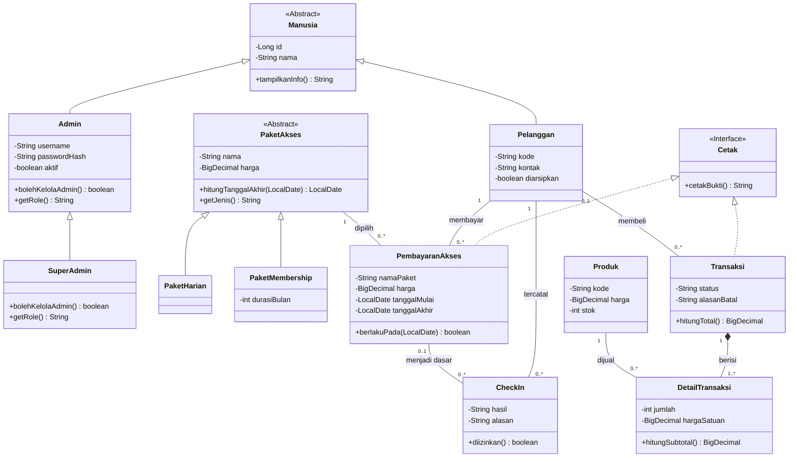
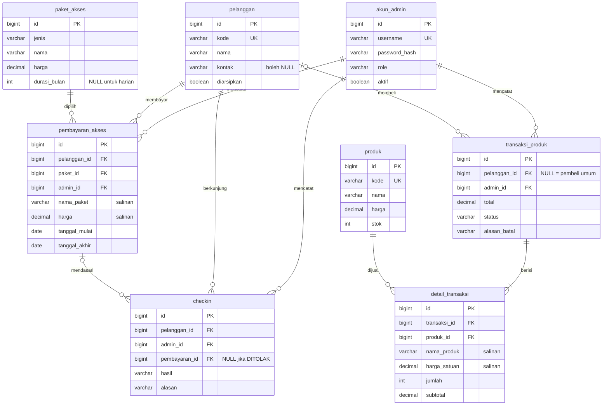

# Diagram IndiGym (versi sederhana)

Diagram ini sesuai kode yang ada sekarang, bukan rancangan awal. Hanya atribut dan method penting yang ditampilkan.

## Alur antar lapisan

Satu arah saja, tidak boleh melompat lapisan.

**FXML → Controller → Service → DAO → MySQL**

| Lapisan | Tugas | Contoh |
| --- | --- | --- |
| FXML | Tata letak layar (dibuat di Scene Builder) | `pelanggan.fxml` |
| Controller | Ambil input, panggil service, tampilkan hasil | `PelangganController` |
| Service | Aturan bisnis, melempar `IllegalArgumentException` jika salah | `PelangganService` |
| DAO | Hanya SQL dengan `PreparedStatement` | `PelangganDAO` |
| Model | Objek data dan aturan kecil milik objek itu | `Pelanggan` |

## Class diagram

## Konsep PBO dan lokasinya

| Konsep | Di mana |
| --- | --- |
| Abstraksi | `Manusia` dan `PaketAkses` (abstract, tidak bisa di-`new`) |
| Pewarisan | `Admin`/`Pelanggan` dari `Manusia`; `SuperAdmin` dari `Admin`; `PaketHarian`/`PaketMembership` dari `PaketAkses` |
| Polimorfisme | `bolehKelolaAdmin()` dan `hitungTanggalAkhir()` memberi hasil berbeda tergantung tipe objeknya; `MainApp.tampilkanBukti(Cetak)` menerima apa saja yang `Cetak` |
| Interface | `Cetak`, dipakai `PembayaranAkses` dan `Transaksi` |
| Enkapsulasi | Field `private`; `Produk.setStok` menolak nilai negatif |
| Komposisi | `Transaksi` memiliki daftar `DetailTransaksi` |

## ERD (8 tabel)

Dua tempat memakai transaksi database (`commit` dan `rollback`): **visit** (`PelangganDAO.simpanVisitDanCheckIn`) dan **checkout/pembatalan penjualan** (`PenjualanDAO.simpanTransaksi`, `batalkanTransaksi`).

## Yang sengaja tidak ada dibanding dokumen asli

Tabel `hak_akses` (digabung ke `pembayaran_akses`), `mutasi_stok`, pembatalan pembayaran akses, `requestId`/retry, `session_version`, `Task` di background, dan konversi zona waktu UTC.
